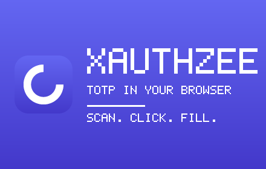
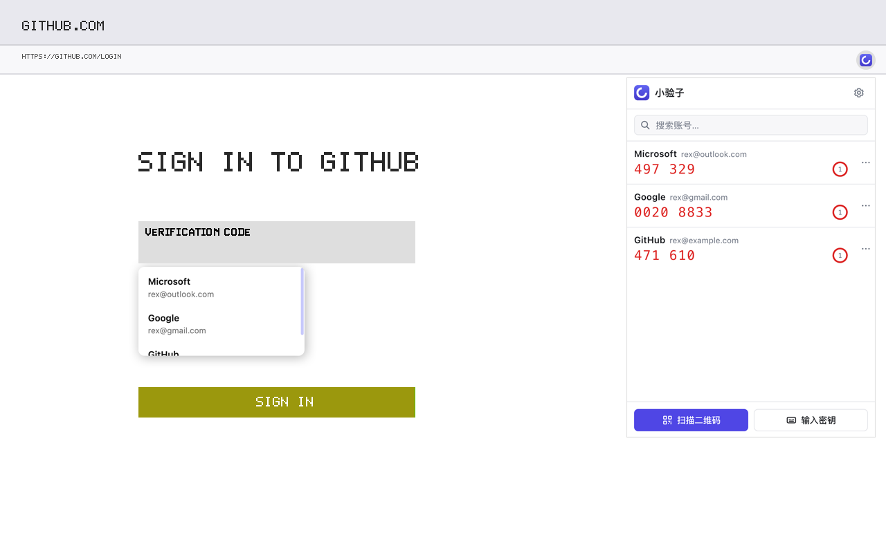
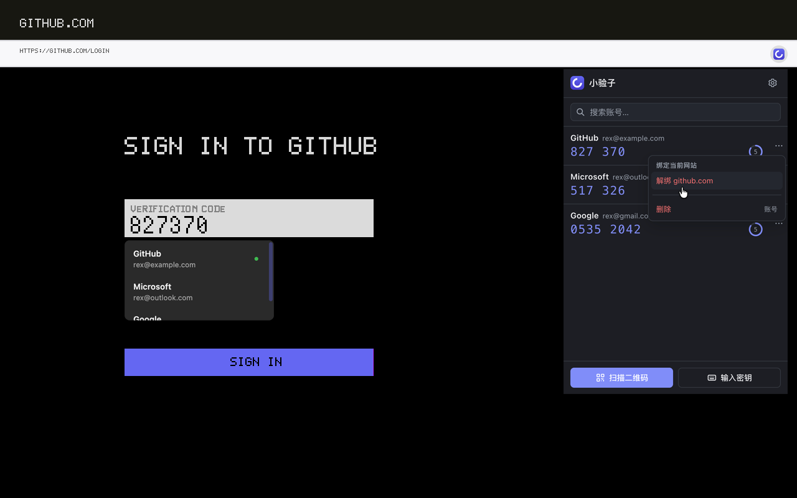
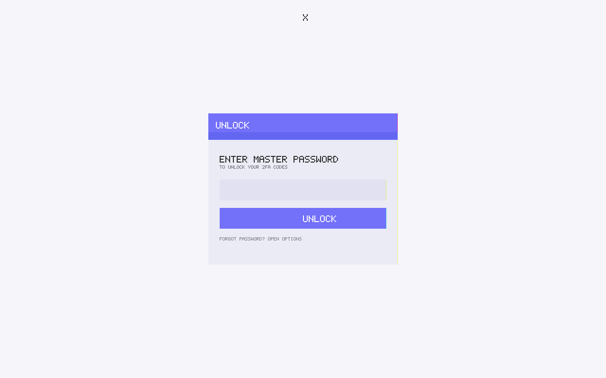

# XAuthZee / 小验子

**[English](README.md) | [中文](README.zh.md)**

A Time-based One-Time Password (TOTP / RFC 6238) authenticator that
lives inside your browser. Scan a QR code from any page, then fill your
one-time code with a single click. Optional master-password encryption,
cross-device sync through your browser's own infrastructure, zero data
leaves your device.

<p align="center">
  
</p>

|  |  |
| --- | --- |
|  |  |
|  |  |

## Why XAuthZee

Most authenticator apps live on a separate device, which means
switching windows to grab a code. XAuthZee puts the codes where you
already are — the browser tab that is asking for them.

## Features

- **Scan any QR on the page.** Click the scan button, drag a rectangle
  over the QR code. XAuthZee reads it, parses the `otpauth://` URL,
  and saves the account.
- **One-click fill.** Focus a one-time-code input on any site and
  XAuthZee shows a small panel with the matching code. Pick it and
  the code is typed into the page (or copied to the clipboard as a
  fallback when the site blocks scripting).
- **Host bindings.** Bind accounts to specific hostnames so that when
  you visit, say, `github.com`, the right code is at the top of the
  list.
- **Master password (optional).** Encrypt your secret keys with a
  password you choose. The derived key lives in session storage and
  is cleared when the browser closes. The auto-lock timer (5/15/30/60
  minutes or never) and the system's own lock screen both lock the
  extension immediately.
- **Import / export.** Move accounts between devices as JSON (with
  optional password-protected encryption). You can also paste a
  `otpauth-migration://` link (Google Authenticator's transfer
  format) or its QR screenshot.
- **Cross-device sync.** Because accounts are stored in
  `chrome.storage.sync`, they show up on every Chrome and Edge you
  sign in to.
- **i18n.** English and Simplified Chinese UI; the extension follows
  the browser's language.

## Install

The extension is published on the Chrome Web Store and Edge Add-ons:

- **Chrome**: [Chrome Web Store](https://chrome.google.com/webstore/detail/xauthzee) (link after publication)
- **Edge**: [Edge Add-ons](https://microsoftedge.microsoft.com/addons/detail/xauthzee) (link after publication)

For development, see the [Building from source](#building-from-source)
section below.

## Permissions, briefly

XAuthZee asks for the minimum set of permissions Chrome / Edge
require and nothing more:

| Permission     | Why                                                                                          |
| -------------- | -------------------------------------------------------------------------------------------- |
| `storage`      | Save accounts and preferences locally; sync through your browser.                            |
| `activeTab`    | Read the current tab's URL on user click, to bind a host or capture a QR.                    |
| `scripting`    | Inject the QR region-selector content script on user action.                                  |
| `alarms`       | Schedule the master-password auto-lock timer.                                                |
| `idle`         | Lock the extension when the operating system locks.                                          |

No analytics, no telemetry, no remote code, no third-party SDKs. The
extension is fully bundled in the published zip; opening the source
shows every line of executable code.

## Privacy

XAuthZee's privacy promise: **all your data stays on your device.**

- All account data lives in `chrome.storage.sync` on your device.
  Cross-device sync is handled by your browser (Chrome Sync or
  Microsoft Account), never by any server we operate.
- The extension never makes HTTP requests to any server we operate.
  The only `fetch()` call processes a `data:` URI from
  `chrome.tabs.captureVisibleTab` when you click the scan button.
- No analytics, no tracking, no advertising, no crash reporting.

The full privacy policy is at
[`store-assets/privacy.md`](store-assets/privacy.md). The
[Chrome / Edge store listing](store-assets/listing/) has the
plain-text version ready to paste into the developer console.

## Building from source

Requirements: **Node 20+** (tested on Node 24).

```bash
git clone https://github.com/takmartian/xAuthZee.git
cd xAuthZee
npm install        # ~30s, installs WXT + React + jsqr + otpauth
npm run dev        # WXT dev server with HMR
```

The dev server mounts the extension at `.output/chrome-mv3/`; load
that folder in `chrome://extensions/` with "Developer mode" on.

### Common scripts

| Command                | What it does                                                                |
| ---------------------- | --------------------------------------------------------------------------- |
| `npm run dev`          | WXT dev server (Chrome target).                                              |
| `npm run dev:edge`     | WXT dev server (Edge target).                                                |
| `npm run build`        | Production build to `.output/chrome-mv3/`.                                  |
| `npm run build:edge`   | Production build to `.output/edge-mv3/`.                                     |
| `npm run zip`          | Build + zip for Chrome Web Store.                                            |
| `npm run zip:edge`     | Build + zip for Edge Add-ons.                                                |
| `npm run compile`      | TypeScript type check only (`tsc --noEmit`).                                  |
| `npm test`             | Unit tests (`node --test tests/*.test.ts`).                                  |
| `npm run icons`        | Regenerate the four extension icons in `public/icon/`.                       |
| `npm run store-assets` | Regenerate promo tiles + screenshot placeholders in `store-assets/`.        |

### Submitting to the stores

See [`store-assets/README.md`](store-assets/README.md) for the full
checklist and copy-paste answers for each store's privacy form.

## Project structure

```
.
├── components/           # React components (CodeRow, AddDialog, ...)
├── entrypoints/
│   ├── background.ts             # Service worker (storage proxy, alarm, idle)
│   ├── popup/                    # The toolbar popup (React)
│   ├── options/                  # The settings page (React)
│   ├── otpfill.content/          # Content script: detect OTP fields, show panel
│   └── qrselect.content/         # Content script: QR region selector overlay
├── lib/                  # Framework-free logic (vault, crypto, lock, transfer, …)
│   ├── crypto.ts                 # PBKDF2 + AES-GCM (WebCrypto wrappers)
│   ├── vault.ts                  # Storage layout (acct:<id>, index, prefs)
│   ├── lock.ts                   # plaintext / locked / unlocked state machine
│   ├── secrets.ts                # enc1: secret encryption migration
│   ├── transfer.ts               # JSON import/export (plain + encrypted)
│   ├── ga-migration.ts           # Google Authenticator otpauth-migration:// parser
│   ├── qr/decode.ts              # jsQR wrapper
│   ├── totp.ts                   # TOTP code generation
│   ├── detect.ts                 # OTP input field detection (incl. six-grid)
│   └── domain.ts                 # Host matching (exact / registrable / shared)
├── tests/                # node --test unit tests
├── scripts/              # Build-time helpers
│   ├── gen-icons.mjs             # Generate 16/32/48/128 PNG icons
│   └── gen-store-assets.mjs      # Generate promo tiles + screenshot placeholders
├── styles/               # Shared CSS (theme tokens)
├── store-assets/         # Material for Chrome Web Store / Edge Add-ons
│   ├── privacy.md                # Privacy policy
│   ├── listing/                  # Description + privacy practices (plain text)
│   ├── promo/                    # 440x280, 920x680, 1400x560 promo tiles
│   └── screenshots/              # 1280x800 screenshots (placeholders)
└── wxt.config.ts        # WXT manifest config (permissions, locales)
```

## Security notes

- **Master password cannot be recovered.** If you forget it, the
  encrypted secrets are unrecoverable by design. Reset the extension
  in options → security → "Turn off encryption" if you can still
  remember it; otherwise re-add accounts from their original QR
  codes.
- **`session.derivedKey` never syncs.** It lives only in
  `chrome.storage.session`, which is per-device. The master-password
  flow is: each device enters the password independently, derives
  its own key in PBKDF2, and uses it to decrypt the synced
  `enc1:`-encrypted secrets.
- **No host permission.** We use `activeTab` (Chrome MV3's
  minimum-privilege alternative) instead of `<all_urls>`.

## Development workflow

```bash
# Quick iteration:
npm run dev
#   ↪ WXT rebuilds on file change. Reload the extension in
#     chrome://extensions/ to see popup / options updates;
#     content scripts hot-reload automatically.

# Run the test suite:
npm test

# Type check:
npm run compile
```

The codebase is intentionally framework-free outside React: `lib/`
has zero React dependencies, so it can be unit-tested under plain
`node --test` with no DOM mocks.

## License

MIT — see [`LICENSE`](LICENSE).

## Acknowledgments

- [`jsQR`](https://github.com/cozmo/jsQR) — pure-JavaScript QR decoder
  that powers the in-page scan flow.
- [`otpauth`](https://github.com/hectorm/otpauth) — RFC 6238 TOTP /
  HOTP reference implementation that backs the `otpauth://` parser
  and the code generator.
- [WXT](https://wxt.dev) — the build framework that turns this
  repo into a signed MV3 extension with one command.
