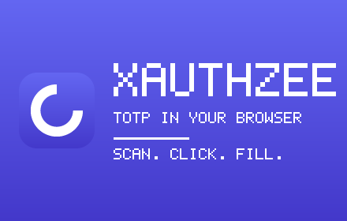
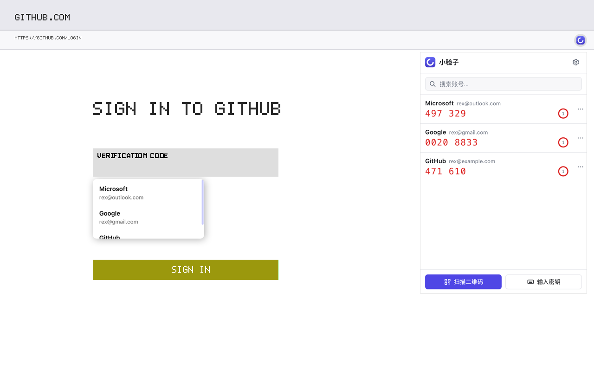
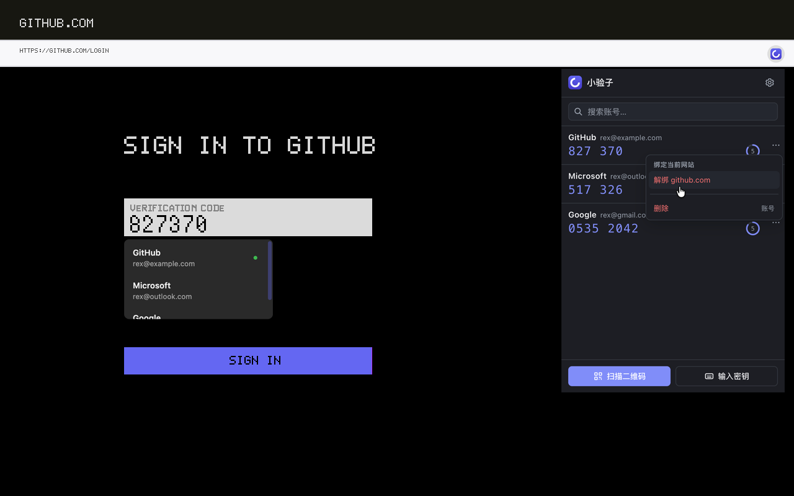
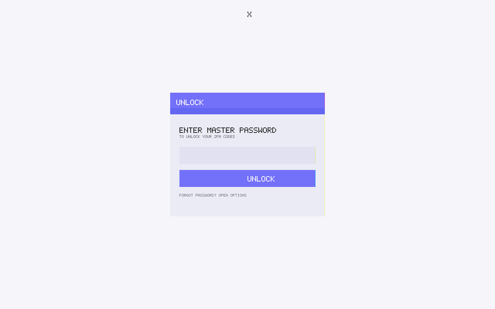

# XAuthZee / 小验子

**[English](README.md) | [中文](README.zh.md)**

一个跑在浏览器里的 TOTP（基于时间的一次性密码，RFC 6238）动态验证码工具。在任意页面上框选二维码即可添加账号，点一下就能把验证码填进输入框。可选主密码加密；通过浏览器自身的同步机制在多设备间同步；数据全留本地。

<p align="center">
  
</p>

|  |  |
| --- | --- |
|  |  |
|  |  |

## 为什么用小验子

大多数验证器 App 在另一台设备上，用的时候得切窗口去抄验证码。小验子把验证码放到你已经在用的那个标签页里 —— 就是正在让你输验证码的那个。

## 功能

- **框选任意二维码**。点扫描按钮，在页面上拖一个框框住 QR，小验子识别后解析 `otpauth://` 链接并保存账号。
- **一键填入**。在任意网站的 OTP 输入框上获得焦点，小验子弹出一个小面板列出匹配的验证码。点一下，验证码就被填进页面（如果页面禁止脚本，就回退复制到剪贴板）。
- **域名绑定**。把账号绑到指定 hostname 后，访问 `github.com` 时对应账号会排到列表顶部。
- **主密码（可选）**。用你自己设的密码加密 secret key。派生 key 只在 session storage 里，关闭浏览器就消失。自动锁定时器（5/15/30/60 分钟或从不）和系统锁屏都会立即上锁。
- **导入 / 导出**。账号列表可以 JSON 形式在设备间迁移（可选密码加密）。也支持粘贴 `otpauth-migration://` 链接（Google Authenticator 的迁移格式）或其 QR 截图。
- **跨设备同步**。账号存在 `chrome.storage.sync`，登同一浏览器账号的 Chrome / Edge 都会自动同步。
- **i18n**。英文 + 简体中文 UI，跟着浏览器语言走。

## 安装

扩展已发布到 Chrome Web Store 和 Edge Add-ons：

- **Chrome**：[Chrome Web Store](https://chrome.google.com/webstore/detail/xauthzee)（发布后填入）
- **Edge**：[Edge Add-ons](https://microsoftedge.microsoft.com/addons/detail/xauthzee)（发布后填入）

本地开发见下面的 [从源码构建](#从源码构建)。

## 权限说明

小验子只申请 Chrome / Edge 必须的最小权限：

| 权限          | 用途                                                              |
| ------------ | ----------------------------------------------------------------- |
| `storage`    | 本地保存账号和偏好，并通过浏览器自带机制同步                       |
| `activeTab`  | 用户点击时读取当前标签页 URL（用于「绑定当前网站」和扫描二维码截取） |
| `scripting`  | 用户触发扫描时按需注入 QR 框选遮罩                                |
| `alarms`     | 调度主密码自动锁定时器                                            |
| `idle`       | 系统锁屏时立即上锁                                                |

无埋点、无遥测、无远程代码、无第三方 SDK。扩展所有代码都打包在发布 zip 里 —— 打开源码就能看到每一行可执行代码。

## 隐私

小验子的承诺：**所有数据都留在你的设备上。**

- 所有账号数据存在你设备的 `chrome.storage.sync` 里。跨设备同步由你的浏览器（Chrome Sync 或 Microsoft Account）处理，我们运营的任何服务器都不接触。
- 扩展从不向我们运营的任何服务器发 HTTP 请求。唯一的 `fetch()` 调用是处理扫描按钮触发的 `chrome.tabs.captureVisibleTab` 返回的 `data:` URI。
- 无埋点、无追踪、无广告、无崩溃报告。

完整隐私声明见 [`store-assets/privacy.md`](store-assets/privacy.md)。[商店上架文案](store-assets/listing/) 有可直接复制粘贴到 dev console 的纯文本版本。

## 从源码构建

环境要求：**Node 20+**（在 Node 24 上测过）。

```bash
git clone https://github.com/takmartian/xAuthZee.git
cd xAuthZee
npm install        # ~30s，安装 WXT + React + jsqr + otpauth
npm run dev        # WXT dev server，带 HMR
```

dev server 把扩展构建到 `.output/chrome-mv3/`，到 `chrome://extensions/` 打开「开发者模式」加载这个目录即可。

### 常用脚本

| 命令                  | 作用                                                          |
| -------------------- | ------------------------------------------------------------- |
| `npm run dev`        | WXT dev server（Chrome 目标）                                  |
| `npm run dev:edge`   | WXT dev server（Edge 目标）                                    |
| `npm run build`      | 生产构建到 `.output/chrome-mv3/`                                |
| `npm run build:edge` | 生产构建到 `.output/edge-mv3/`                                  |
| `npm run zip`        | 构建并打包成 Chrome Web Store 上传 zip                          |
| `npm run zip:edge`   | 构建并打包成 Edge Add-ons 上传 zip                             |
| `npm run compile`    | 仅做 TypeScript 类型检查（`tsc --noEmit`）                     |
| `npm test`           | 单元测试（`node --test tests/*.test.ts`）                       |
| `npm run icons`      | 重新生成 `public/icon/` 下的四个扩展图标                       |
| `npm run store-assets` | 重新生成 `store-assets/` 下的 promo + screenshot 占位       |

### 提交到商店

完整 checklist 和每个商店隐私表单的复制粘贴答案见 [`store-assets/README.md`](store-assets/README.md)。

## 项目结构

```
.
├── components/                # React 组件（CodeRow, AddDialog, ...）
├── entrypoints/
│   ├── background.ts          # Service worker（storage 代理、alarm、idle）
│   ├── popup/                 # 工具栏 popup（React）
│   ├── options/               # 设置页（React）
│   ├── otpfill.content/       # 内容脚本：检测 OTP 输入框、显示浮层
│   └── qrselect.content/      # 内容脚本：QR 框选遮罩
├── lib/                       # 不依赖框架的业务逻辑
│   ├── crypto.ts              # PBKDF2 + AES-GCM（WebCrypto 包装）
│   ├── vault.ts               # 存储布局（acct:<id>、index、prefs）
│   ├── lock.ts                # plaintext / locked / unlocked 状态机
│   ├── secrets.ts             # enc1: secret 加密迁移
│   ├── transfer.ts            # JSON 导入导出（明文 + 加密）
│   ├── ga-migration.ts        # Google Authenticator otpauth-migration:// 解析
│   ├── qr/decode.ts           # jsQR 包装
│   ├── totp.ts                # TOTP 验证码生成
│   ├── detect.ts              # OTP 输入框检测（含六宫格）
│   └── domain.ts              # 域名匹配（exact / registrable / shared）
├── tests/                     # node --test 单元测试
├── scripts/                   # 构建辅助
│   ├── gen-icons.mjs          # 生成 16/32/48/128 PNG 图标
│   └── gen-store-assets.mjs   # 生成 promo + screenshot 占位
├── styles/                    # 共享 CSS（主题 token）
├── store-assets/              # Chrome Web Store / Edge Add-ons 上架材料
│   ├── privacy.md             # 隐私声明
│   ├── listing/               # 描述 + 隐私实务规范（纯文本）
│   ├── promo/                 # 440x280、920x680、1400x560 promo tiles
│   └── screenshots/           # 1280x800 截屏（占位）
└── wxt.config.ts             # WXT manifest 配置（权限、locale）
```

## 安全说明

- **主密码无法找回**。忘了密码，加密的 secret 是设计上无法恢复的。在「设置 → 安全 → 关闭加密」还能用原密码关掉；想不起来就重新从原始 QR 添加账号。
- **`session.derivedKey` 不跨设备同步**。它只存在 `chrome.storage.session` 里，每台设备独立。主密码流程：每台设备各自输密码、PBKDF2 派生自己的 key、用来解密同步下来的 `enc1:` 密文。
- **不申请 host permission**。我们用 `activeTab`（Chrome MV3 推荐的最小权限替代方案）代替 `<all_urls>`。

## 开发流程

```bash
# 快速迭代：
npm run dev
#   ↪ WXT 文件改动时自动重建。在 chrome://extensions/ 重新加载
#     扩展即可看到 popup / options 变化；内容脚本自动热重载。

# 跑测试：
npm test

# 类型检查：
npm run compile
```

代码库刻意保持 `lib/` 零 React 依赖：可以用纯 `node --test` 跑（无需 DOM mock）做单元测试。

## 许可证

MIT —— 见 [`LICENSE`](LICENSE)。

## 致谢

- [`jsQR`](https://github.com/cozmo/jsQR) — 纯 JS QR 解码器，驱动页面内扫描流程
- [`otpauth`](https://github.com/hectorm/otpauth) — RFC 6238 TOTP/HOTP 参考实现，支撑 `otpauth://` 解析和验证码生成
- [WXT](https://wxt.dev) — 一条命令把本仓库变成已签名的 MV3 扩展的构建框架
